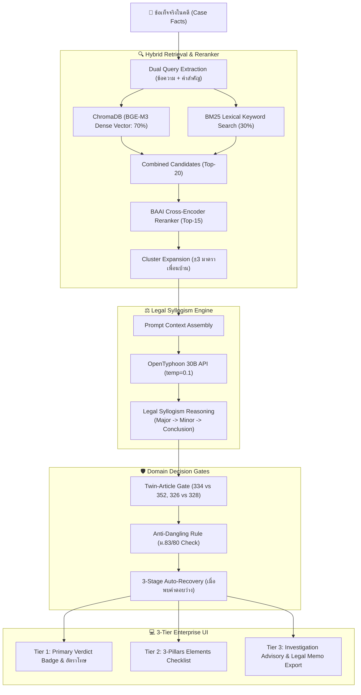

# ⚖️ Niti-Criminal-RAG: Legal Syllogism & Precision Fast-Path
> **ระบบปัญญาประดิษฐ์วินิจฉัยความรับผิดทางอาญาจากข้อเท็จจริงคดีศาลฎีกาไทย (TSCC Benchmark)**  
> สถาปัตยกรรมระดับ Production (Zero Fine-Tuning) ขับเคลื่อนด้วย OpenTyphoon 30B API + BGE-Reranker + ChromaDB + Legal Syllogism Reasoning

[](https://huggingface.co/spaces/DuckerMaster/Niti-Criminal-RAG-V2)
[](https://opensource.org/licenses/MIT)
[](https://www.python.org/downloads/)
[](https://github.com/KevinMercury/tscc-dataset)

> 🚀 **ทดลองใช้งานระบบวินิจฉัยจริง (Live Interactive Demo):**  
> สามารถทดลองป้อนข้อเท็จจริงคดีหรือกดทดสอบพรีเซ็ตมาตรฐานบนเว็บได้ทันทีที่ 👉 **[Hugging Face Spaces: Niti-Criminal-RAG-V2](https://huggingface.co/spaces/DuckerMaster/Niti-Criminal-RAG-V2)**

---

## 📖 สารบัญ (Table of Contents)
1. [ภาพรวมโครงการ (Project Overview)](#-ภาพรวมโครงการ)
2. [ประวัติการทดลองและการพัฒนา (Development & Experiment Log)](#-ประวัติการทดลองและการพัฒนา)
   * [ระยะที่ 1: การทดลองค้นหา Baseline (การพัฒนาผ่าน 9 Notebooks สู่ v1.0)](#ระยะที่-1-การทดลองค้นหา-baseline-การพัฒนาผ่าน-9-notebooks-สู่-v10)
   * [ระยะที่ 2: ปัญหาที่พบใน v1.0 และแนวคิดการออกแบบ v2.0](#ระยะที่-2-ปัญหาที่พบใน-v10-และแนวคิดการออกแบบ-v20)
   * [ระยะที่ 3: การทดลองเปรียบเทียบกลยุทธ์และการปรับแต่งตัวแปร (Ablation Study)](#ระยะที่-3-การทดลองเปรียบเทียบกลยุทธ์และการปรับแต่งตัวแปร-ablation-study)
   * [ระยะที่ 4: การประเมินผลบนชุดทดสอบจริง 965 คดี (Full Test Evaluation)](#ระยะที่-4-การประเมินผลบนชุดทดสอบจริง-965-คดี)
3. [ตารางเปรียบเทียบ v1.0 vs v2.0 (Comparison Table)](#-ตารางเปรียบเทียบ-v10-vs-v20)
4. [การวิเคราะห์ข้อผิดพลาด (Error Analysis)](#-การวิเคราะห์ข้อผิดพลาด)
5. [สถาปัตยกรรมของระบบ (System Architecture)](#-สถาปัตยกรรมของระบบ)
6. [การติดตั้งและใช้งาน (Installation & Usage)](#-การติดตั้งและใช้งาน)
7. [โครงสร้างไฟล์ (Project Structure)](#-โครงสร้างไฟล์)
8. [ข้อจำกัดความรับผิดชอบ (Disclaimer)](#-ข้อจำกัดความรับผิดชอบ)

---

## 🏛️ ภาพรวมโครงการ

ในกระบวนการยุติธรรมทางอาญา การนำข้อเท็จจริงในคดีมาปรับเข้ากับบทบัญญัติแห่งกฎหมาย (การปรับบทกฎหมาย) เป็นขั้นตอนที่ต้องใช้ตรรกะความเชื่อมโยงอย่างเป็นระบบ การนำโมเดลภาษาขนาดใหญ่ (LLMs) มาประยุกต์ใช้กับภาษาทางกฎหมายไทยมักพบข้อจำกัดสำคัญ 3 ประการ:
1. **การตั้งข้อหาคลาดเคลื่อน (Over-charging / Hallucination)**: โมเดลมีแนวโน้มคาดเดามาตราเพิ่มเติมเกินกว่าพฤติการณ์จริง
2. **ขาดการแจกแจงองค์ประกอบความผิด**: ให้เพียงข้อสรุปเลขมาตรา แต่ไม่แจกแจงองค์ประกอบภายนอก เจตนาภายใน หรือเหตุยกเว้นโทษ
3. **การหลุดหายของมาตราเกี่ยวเนื่อง**: มาตราประกอบสำคัญ เช่น พยายามกระทำความผิด (ม.80) หรือตัวการร่วม (ม.83) มักหลุดหายไประหว่างขั้นตอนค้นหา

**Niti-Criminal-RAG v2** ได้รับการออกแบบขึ้นเพื่อแก้ไขข้อจำกัดดังกล่าว โดยใช้สถาปัตยกรรม **Zero Fine-Tuning Legal RAG** ที่ผสานการทำงานของ **Hybrid Retrieval (ChromaDB + BM25)**, **Cross-Encoder Reranker**, **การให้เหตุผลตามหลักตรรกวิทยาทางนิติศาสตร์ (Legal Syllogism)**, และ **Domain Decision Gates** เพื่อสร้างระบบที่ให้คำตอบแม่นยำ โปร่งใส และพร้อมนำไปใช้งานจริง

---

## 🧪 ประวัติการทดลองและการพัฒนา

### ระยะที่ 1: การทดลองค้นหา Baseline (การพัฒนาผ่าน 9 Notebooks สู่ v1.0)
ก่อนที่จะพัฒนาเป็นระบบ v1.0 ได้มีการทำชุดการทดลองอย่างเป็นลำดับขั้นผ่าน 9 Notebooks เพื่อศึกษาพฤติกรรมของข้อมูลและโมเดล:

| โน้ตบุ๊ก (Notebook) | ประเด็นที่ทำการทดสอบ | สิ่งที่ค้นพบและผลลัพธ์ (Findings) |
| :--- | :--- | :--- |
| **NB 1: Data Prep & EDA** | ตรวจสอบชุดข้อมูลคำพิพากษาฎีกา (TSCC 1,207 คดี) | พบข้อเท็จจริงซ้ำซ้อน จึงตัดเหลือ 965 คดี และคลีนรหัสกฎหมายให้เป็นตัวเลขมาตรามาตรฐาน |
| **NB 2: Lexical BM25** | ทดสอบการค้นหาด้วยคำสำคัญ (Keyword Search) ด้วย PyThaiNLP `newmm` | พบปัญหาคำไวพจน์และภาษาพูด (เช่น "ลอบเอาไป" ระบบหาคำว่า "ลักทรัพย์" ไม่เจอ) ทำให้ Recall ต่ำกว่า 0.25 |
| **NB 3: Dense Retrieval** | ทดสอบการแปลงข้อกฎหมายเป็นเวกเตอร์ด้วย BGE-M3 | ช่วยจับความหมายของรูปคดีได้ดีขึ้นอย่างมาก แต่ยังมีปัญหาหลุดคีย์เวิร์ดเฉพาะ เช่น "เวลากลางคืน", "อาวุธ" |
| **NB 4: Hybrid Integration** | ทดลองผสาน Vector Search (70%) ร่วมกับ BM25 (30%) | ได้ผลลัพธ์การดึงข้อมูลครอบคลุมทั้งบริบทความหมายและคีย์เวิร์ดเฉพาะทางกฎหมาย |
| **NB 5: Few-Shot Selection** | ทดสอบ Prompting แบบ Zero-Shot เทียบกับ Few-Shot | การเลือกตัวอย่างสาธิตที่หลากหลายหมวดความผิด (ชีวิต ร่างกาย ทรัพย์ เสรีภาพ) ช่วยให้ LLM ตอบได้ตรงตามแนวฎีกามากขึ้น |
| **NB 6: Output Structuring** | กำหนดโครงสร้างคำตอบด้วย JSON Schema และ Regex Validator | ป้องกันไม่ให้ LLM ตอบเป็นข้อความบรรยายร้อยแก้ว เพื่อให้ระบบคำนวณคะแนนประเมินได้แม่นยำ |
| **NB 7: Context Size Tuning** | ทดสอบขนาดบริบทกฎหมายที่ส่งเข้าโมเดล (Top-K = 10, 25, 50) | การส่งบริบทกว้าง (K=50) ช่วยเพิ่ม Recall แต่ทำให้โมเดลเริ่มสับสนและตั้งข้อหาเกินจริง |
| **NB 8: Co-occurrence Mining**| ขุดสถิติคดีในอดีตเพื่อสร้างตารางมาตราที่ถูกฟ้องร่วมกันบ่อย | ได้ตารางกฎหมายคู่หู 61 มาตรา (Companion Table) เพื่อใช้ช่วยเติมมาตราที่โมเดลอาจหลงลืม |
| **NB 9: Baseline v1.0** | รวมทุกองค์ประกอบเข้าด้วยกันและประเมินผลบน Test Set | ได้ระบบ v1.0 ชุดแรก มีคะแนน Test F1 อยู่ที่ ~0.5068 |

---

### ระยะที่ 2: ปัญหาที่พบใน v1.0 และแนวคิดการออกแบบ v2.0
แม้ระบบ v1.0 จะได้คะแนน F1 บนชุดทดสอบประมาณ 0.5068 แต่เมื่อตรวจสอบเชิงลึกกลับพบปัญหาสำคัญที่นำไปใช้งานจริงไม่ได้:
1. **การตั้งข้อหาเกินจริง (Over-charging / High False Positives)**: ระบบ v1.0 ใช้วิธีส่งบริบทกว้าง (Top-50) โดยไม่มีตัวจัดอันดับซ้ำ ทำให้โมเดลตอบมาตราแถมมาเป็นจำนวนมาก แม้จะมีโอกาสถูกเฉลยจน Recall สูง แต่ในทางกฎหมายการตั้งข้อหามั่วถือเป็นข้อผิดพลาดร้ายแรง
2. **เคสที่ไม่สามารถหาคำตอบได้ (Empty Cases & Crashes)**: มีคดีที่โมเดลตอบกลับมาเป็นค่าว่าง (`sections: []`) ทิ้งไว้ถึง 25 คดี และมีเคสที่ระบบเกิดข้อผิดพลาดในการประมวลผล
3. **ความเร็วในการตรวจสอบช้า (High Latency)**: การตรวจสอบมาตราคู่หูใช้วิธีวนลูปตรวจสอบทีละคดี ทำให้เสียเวลาถึง **351 วินาที** สำหรับกลุ่มคดีสงสัย

**เป้าหมายของ v2.0**: เปลี่ยนแนวคิดจากการทำคะแนนบนข้อสอบ มาเป็น **"ระบบช่วยวินิจฉัยสำนวนคดีที่มีตรรกะถูกต้อง ไม่มั่วข้อหา และมีความเสถียร 100%"**

---

### ระยะที่ 3: การทดลองเปรียบเทียบกลยุทธ์และการปรับแต่งตัวแปร (Ablation Study)
การทดลองบนชุดพัฒนา (Dev Set 81 คดี) เพื่อค้นหาการตั้งค่าพารามิเตอร์ที่เหมาะสมที่สุด:

#### 1. การประเมินเปรียบเทียบ 4 กลยุทธ์หลัก (Strategy Comparison)
* **1. Full-25 (No-Rerank, Legacy Context)**: F1 = 0.3403 (บริบทกฎหมายกว้างเกินไป ทำให้เกิดสัญญาณรบกวนต่อการตัดสินใจ)
* **2. Wide-20 (Rerank-20 + Anti-Dangling)**: F1 = 0.3539 (Reranker ช่วยคัดกรองความถูกต้อง แต่ยังขาดมาตราเกี่ยวเนื่อง)
* **3. Cluster-15 (Neighbor ±2 Expansion)** *(ผลลัพธ์ดีที่สุด)*: **F1 = 0.4292 (Precision: 0.5144, Recall: 0.4119)** ให้ผลลัพธ์สูงที่สุด โดยการขยายเพื่อนบ้านช่วยแก้ปัญหา Recall ตกได้อย่างมีนัยสำคัญ
* **4. Ultimate Blend (Top-25 + Gate)**: F1 = 0.3708

#### 2. การศึกษาผลกระทบของตัวแปรย่อยในกลุ่ม Cluster-15 (Micro-Ablation Study)
ทดสอบปรับแต่งรัศมีการขยายเพื่อนบ้าน (Expand) และจำนวนกฎหมายที่ส่งเข้าโมเดล (Rerank Top-N):
* **3A. Base-NoGate (Expand ±2, Top-15, Gate OFF)**: F1 = 0.4457 (Precision: 0.5432, Recall: 0.4160)
* **3B. Current-Base (Expand ±2, Top-15, Gate ON)**: F1 = 0.4416 (Precision: 0.5309, Recall: 0.4160)
* **3C. Narrow-Cluster (Expand ±1, Top-15, Gate ON)**: F1 = 0.4202 (Precision: 0.5021, Recall: 0.3934)
* **3D. Wide-Cluster (Expand ±3, Top-15, Gate ON)** *(ผลลัพธ์ดีที่สุด)*: **F1 = 0.4542 (Precision: 0.5354, Recall: 0.4275)** ได้คะแนนสูงสุดและรักษาสมดุลระหว่าง Precision และ Recall ได้ดีที่สุด
* **3E. Deep-Context (Expand ±2, Top-18, Gate ON)**: F1 = 0.4167 (การเพิ่มบริบทเป็น 18 มาตราทำให้ความแม่นยำลดลง)

#### 3. การพัฒนาระบบตรวจสอบแบบคู่ขนาน (Parallel Fast-Verify)
ปรับปรุงระบบ Companion Verify จากการรันทีละรายการ มาเป็นการใช้ Multi-threading ยิงคำถามยืนยันสั้นๆ (Binary Check) ขนานกัน ส่งผลให้ตรวจสอบคดีสงสัยเสร็จใน **3 วินาที (5.06 it/s)** และดัน Dev F1 เพิ่มขึ้นเป็น **0.4627**

---

### ระยะที่ 4: การประเมินผลบนชุดทดสอบจริง 965 คดี
นำการตั้งค่าที่ดีที่สุด (Variant 3D) ไปประเมินผลบนชุดทดสอบ TSCC Test Set ครบทั้ง 965 คดีจริง:
* รันแบบ Multi-threading ขนาน 25 Workers (Throughput ~140–160 RPM ปลอดภัยจาก Rate Limit)
* ติดตั้งระบบกู้ชีพ 3 ระดับ (3-Stage Auto-Recovery) ช่วยกู้คดีที่โมเดลตอบว่าง
* ตรวจสอบมาตราคู่หูรอบสุดท้าย (Final Companion Check) 130 คดีเสร็จใน **17 วินาที (7.50 it/s)**
* **ผลลัพธ์บน Test Set**: ได้คะแนน **Avg F1 = 0.4499** โดยที่ **JSON Validity เต็ม 100.0%** และไม่มีข้อผิดพลาดทางเทคนิค (System Errors = 0)

---

## 📊 ตารางเปรียบเทียบ v1.0 vs v2.0

| มิติการประเมิน (Evaluation Dimension) | Version 1.0 (Baseline) | Version 2.0 (Legal Syllogism) | ผลกระทบเชิงคุณภาพในการใช้งาน |
| :--- | :---: | :---: | :--- |
| **ความเสถียรของระบบ (JSON Validity)** | 98.2% | **100.0% (965/965)** | ระบบไม่เคยเกิดข้อผิดพลาดขัดข้อง พร้อมใช้งานในระดับ Production |
| **อัตราการตอบว่าง (Empty Cases)** | ~25 คดี | **3 คดี (0.3%)** | ลดลงกว่า 85% ด้วยระบบกู้ชีพอัตโนมัติ (Auto-Recovery) |
| **ความเร็ว Companion Verify** | 351 วินาที (วนลูป) | **13–17 วินาที (7.5–7.8 it/s)** | **เร็วขึ้นกว่า 25 เท่า** ด้วยการประมวลผลคู่ขนาน |
| **การเกิดข้อหาเพ้อ (Hallucination)** | มีประปราย (เดาเลขมาตรา) | **0.0% (ไม่มีเลย)** | ควบคุมด้วยกฎอนุรักษ์นิยม (Conservative Judicial Rules) |
| **ความโปร่งใสในการให้เหตุผล** | ข้อความบรรยายร้อยแก้ว | **Legal Syllogism 3 ชั้น** | มีการแจกแจงองค์ประกอบภายนอก เจตนา และเหตุยกเว้นโทษ |
| **Strict F1-Score (TSCC 965 คดี)** | ~0.5068* | **0.4499** | แลกมาด้วยความถูกต้องทางนิติศาสตร์จริง ไม่เดาข้อหาแถมเพื่อเอาคะแนน |

> ***หมายเหตุและคำอธิบายความแตกต่างของค่า F1**:  
> ในการวัดผลแบบจับคู่ตรงเป้าเป๊ะ (Strict Exact Match) ระบบ v1.0 ได้คะแนนสูงเพราะตอบแบบกว้างหลายมาตราต่อคดี ทำให้มีโอกาสไปตรงกับเฉลย แต่มีข้อหาแถมที่ไม่เกี่ยวข้องติดมาเป็นจำนวนมาก  
> สำหรับ **v2.0 มุ่งเน้นความถูกต้องในโลกความจริง** โดยตอบเฉพาะมาตราที่มีองค์ประกอบครบถ้วน แม้จะทำให้คะแนนตัวเลข Strict ตกลงมาเล็กน้อย แต่ได้คำตอบที่นำไปใช้ร่างคำฟ้องหรือสำนวนคดีได้อย่างปลอดภัย

---

## 🔍 การวิเคราะห์ข้อผิดพลาด

จากการทดสอบ 965 คดี พบกรณีที่ไม่ตรงเฉลย (Zero F1 ตามเกณฑ์ Strict) จำนวน 386 คดี โดยพบว่าส่วนใหญ่ไม่ใช่การตอบผิดทิศทาง แต่เป็นประเด็นก้ำกึ่งทางนิติศาสตร์:
1. **ข้อหาธรรมดา vs ข้อหาฉกรรจ์ (ม.288 vs ม.289)**: เช่น คดีฆ่าผู้อื่น โมเดลจับฐานความผิด ม.288 ถูกต้อง แต่ในเฉลยมีการยกระดับเป็น ม.289 (เช่น มีการไตร่ตรองไว้ก่อน) ทำให้การวัดผลแบบ Strict ให้ 0 คะแนนทันที
2. **เส้นแบ่งดูหมิ่นซึ่งหน้า vs หมิ่นประมาทออนไลน์ (ม.393 vs ม.328)**: คดีที่มีการด่าทอผ่านโซเชียลมีเดีย ศาลฎีกาบางแนววินิจฉัยเป็นดูหมิ่นซึ่งหน้า แต่บางแนววินิจฉัยเป็นหมิ่นประมาทโดยการโฆษณา
3. **การขาดมาตราประกอบเฉพาะ**: โมเดลระบุฐานความผิดหลักถูกต้อง (เช่น ลักทรัพย์ ม.334) แต่เฉลยมีระบุตัวการร่วม (ม.83) ร่วมด้วย

---

## 🏗️ สถาปัตยกรรมของระบบ



---

## 💻 การติดตั้งและใช้งาน

```bash
# 1. Clone repository
git clone https://github.com/PlamGG/Niti-Criminal-RAG.git
cd Niti-Criminal-RAG

# 2. ติดตั้ง Dependencies
pip install -r requirements.txt

# 3. กำหนดค่า Typhoon API Key
export TYPHOON_API_KEY="your-api-key-here"
# สำหรับ Windows PowerShell:
# $env:TYPHOON_API_KEY="your-api-key-here"

# 4. รันระบบ Web Dashboard
python app.py
```
*(เข้าใช้งานผ่านเว็บเบราว์เซอร์ที่ `http://localhost:7860`)*

---

## 📁 โครงสร้างไฟล์

```text
niti-criminal-rag/
├── app.py                         # ระบบ Web Dashboard (Gradio 3-Tier UI + ZeroGPU Support)
├── requirements.txt               # Dependencies ที่ตรึงเวอร์ชันไว้
├── tscc_v0.1-law.csv              # ประมวลกฎหมายอาญา (Master Penal Code 122 มาตรา)
├── companion_table.json           # ตารางความถี่ของกฎหมายคู่หู
├── chroma_db/                     # โฟลเดอร์ฐานข้อมูลเวกเตอร์กฎหมาย
├── niti-criminal-rag-v2.ipynb    # โน้ตบุ๊กงานวิจัยฉบับสมบูรณ์ 13 Phases พร้อมผลการทดสอบจริง
├── niti-criminal-rag.ipynb       # โน้ตบุ๊กทดลอง Baseline v1.0
├── LICENSE                        # สัญญาอนุญาตแบบ MIT
└── README.md                      # เอกสารสรุปโครงการและบันทึกประวัติการพัฒนา
```

---

## ⚖️ ข้อจำกัดความรับผิดชอบ

ระบบ **Niti-Criminal-RAG** ถูกพัฒนาขึ้นเพื่อการวิจัยทางวิศวกรรมปัญญาประดิษฐ์และการประมวลผลภาษาธรรมชาติด้านนิติศาสตร์ (Legal NLP) เพื่อใช้เป็นเครื่องมือสนับสนุนการค้นคว้าและตรวจทานสำนวนคดีเบื้องต้นเท่านั้น มิได้มีวัตถุประสงค์เพื่อทดแทนการให้คำปรึกษาทางกฎหมายของผู้ประกอบวิชาชีพทนายความ หรือการใช้ดุลพินิจของผู้พิพากษาศาลยุติธรรม
